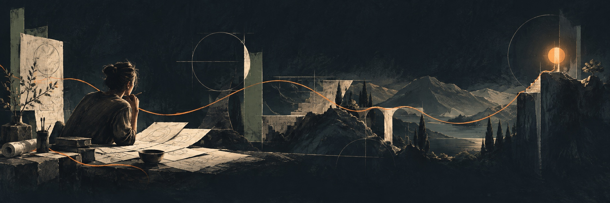

### Hey, I'm Charlex.

Product designer and independent maker in Hangzhou. I bring design and engineering together around a clear goal—from shaping the experience to building the product.

## Products I’m building

<table>
<tr><td>
<h3>✦ PixOnDeck</h3>

<strong>Less prompting. More creating.</strong> AI image recipes and tools for turning ideas into visuals. Find a recipe, make it yours, and create.

把灵感变成图像：发现创意配方，调整内容，开始创作。

  

<a href="https://pixondeck.com">Create with PixOnDeck →</a>

</td></tr>
</table>

<table>
<tr><td>
<h3>☾ Moonlit Tales</h3>

<strong>A little wonder before goodnight.</strong> Personalized audio bedtime stories for kids. Choose a nickname, age, and theme, then listen together.

为孩子定制有声睡前故事，一起听见今晚的想象。

  

<a href="https://moonlittales.app">Discover Moonlit Tales →</a> · <a href="https://apps.apple.com/us/app/id6764512970">Download for iPhone</a>

</td></tr>
</table>

### Selected projects

| | Project | What it does |
| :---: | :--- | :--- |
| 🤖 | [**CodeBuddy**](https://github.com/CharlexH/CodeBuddy) | A tiny Codex desk companion on M5Stack StickS3. |
| 📼 | [**SideB**](https://github.com/CharlexH/SideB) | A cassette-style music player for TrimUI Brick. |
| 📐 | [**ArcGrid**](https://github.com/CharlexH/ArcGrid) | Geometric construction guides from SVGs. |

### 📬 Contact me

- Website: [https://charlex.me](https://charlex.me)
- Email: [zghzhhc@gmail.com](mailto:zghzhhc@gmail.com)
- X: [@CharlexHuang](https://x.com/CharlexHuang)
- Xiaohongshu: [Charlex](https://www.xiaohongshu.com/user/profile/5a199a6edb2e60456682f7f4)
